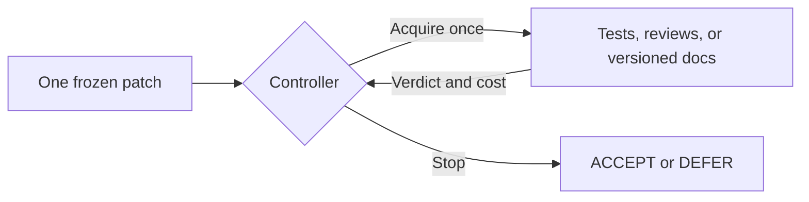

# Dependency-aware verification

**Can a coding agent verify patches more economically by recognizing when its checks share the same evidence?**

Two reviews can agree because both relied on the same outdated API document. Their agreement may add less information than a passing test or a review grounded in the target API version. This project asks whether a small controller can use that relationship to choose the next check—or stop checking—while preserving useful acceptance quality.

**Study status: complete, `NO_GO` for the proposed controller in the tested setting.** The experiment found a useful simpler workflow and stopped before fitting or held-out evaluation. The code, both pilots, failed outputs, and negative result are available for inspection and reuse.

## The idea

Freeze one proposed patch. Each check returns `PASS`, `FAIL`, or `UNKNOWN`, with a measured cost. A controller sees only source-lineage metadata and the outcomes it has requested. It can acquire another check, accept the patch in a disposable copy, or defer it. Each check runs at most once; there is no repair loop.



The intended comparison separates three questions: does adaptive verification help, does dependence information help, and does the proposed structure beat simpler rules or a generic acquisition model? The [research protocol](docs/superpowers/specs/2026-09-29-dependency-aware-verification-design.md) defines the baselines, costs, uncertainty, and gates before later work is allowed.

A small constructed example makes the distinction concrete: with a 50% prior and 80%-accurate reviews, one PASS gives 80% correctness probability. A copied second PASS still gives 80%; genuinely independent PASSes give about 94.1%. This is a mathematical illustration, not a measured model result.

## What happened

The menu contained public executable tests, two differently prompted reviews, and a documentation review, using one frozen local model. R1/R2 sources honestly shared lineage. Two separate pilots used six root problems and four semantic variants per root; variants were clustered, not counted as independent problems.

| Pilot | Natural proposals: correct / wrong | Test-only: correct accepts / wrong accepts / deferrals | Gate |
|---|---:|---:|---|
| Original | 3 / 21 | 3 / 3 / 18 | `INCONCLUSIVE` |
| One permitted fresh revision | 8 / 16 | 8 / 0 / 16 | `NO_GO` |

The fresh pilot's tests caught every specified error, while model reviews rejected every correct patch or returned UNKNOWN. There was no useful acquisition headroom for the special controller. The original pilot remains visible: its tests missed three wrong patches, so the fresh result does not make public tests a general correctness guarantee.

The fresh test-only loss was 5.302 versus 6.296 for universal deferral under the declared penalties. The exploratory root-bootstrap difference was −0.993, with 95% interval **[−2.660, +0.262]**. This small sample does not establish a reliable population improvement. Each pilot also has eight separate eager-documentation proposals; these are not pooled with the natural verifier comparison.

[Full result and limits](reports/final.md) · [Original pilot](reports/m2.md) · [Fresh protocol](reports/replacement-pilot-protocol.md) · [Audit](reports/audit-2026-10-03.md)

## Try it without a model

Use a source checkout and Python 3.12. The CPU examples need no model weights, container engine, credentials, or external service. The core is intended for macOS/Linux; the recorded environment and native adapter are described separately in [reproducibility notes](docs/REPRODUCIBILITY.md).

```bash
git clone https://github.com/arlegotin/DAV.git
cd DAV
python3.12 -m venv .venv
source .venv/bin/activate
python -m pip install -r requirements-core.lock
python -m pip install --no-build-isolation --no-deps -e '.[dev]'
python -m pip check

# See why copied evidence must not count twice.
python examples/copied_evidence.py

# Verify published hashes, replay every saved policy, and reproduce metrics.
python examples/replay_pilots.py

# Run mathematical/protocol controls and ordinary tests.
python -m depverify doctor --fake
python -m depverify simulate --suite core
python -m pytest -q
```

The replay reads saved evidence; it never executes proposal code, calls a model, or writes a research gate. It verifies every trajectory and score for the original 32 and fresh 68 fixed screening policies, retaining their recorded costs. `--json` gives machine-readable output; `--verify-only` checks the artifact inventory.

`simulate` generates explicitly synthetic records under ignored `runs/`. `python -m depverify report` reports those local runs; the published historical result is reproduced by `examples/replay_pilots.py`. Simulation success is implementation evidence, not a scientific GO.

## Reuse the pieces

| Component | What it provides |
|---|---|
| [Probability tables](src/depverify/probability.py) | Validated joint distributions, exact posteriors and predictive marginals, versioned JSON/NPZ persistence |
| [Planner](src/depverify/policy.py) | Exact finite-horizon acquisition over four checks, explicit costs, deterministic stopping and fail-closed behavior |
| [Replay and evaluation](src/depverify/evaluate.py) | Acquired-outcome masking, shared public-failure veto, measured-cost accounting, root-weighted summaries |
| [Runner](src/depverify/runner.py) | Bounded isolated candidate execution, host watchdog, output limits, confirmed cleanup |
| [Benchmark](bench/public) and [evaluators](bench/private) | 48 contracts across 12 root problems, public examples, separate references, deterministic grading and mutation checks |
| [Published artifacts](artifacts/pilots/README.md) | All 64 natural/eager proposal bundles, pilot raw model/container outputs, decisions, scores, framing diagnostics, provenance hashes |

The mathematical planner is implemented and tested. Learned I/P/J fitting, the full learned baseline ladder, locked held-out evaluation, and live/stress panels were **not implemented or executed**, because their preceding research gate failed. The native inference adapter records one tested model setting; the idea and CPU planning/replay code are not tied to that hardware.

## Evidence boundaries

Correct means passing the specified evaluator, not universal semantic correctness. Labels and hidden expected outputs remain outside model inputs and policy execution. `bench/private` means private **to the evaluated agent**; these research definitions are intentionally published. Proposal text is data and must be executed only through the isolated runner, never on the host.

The [portable inventory](artifacts/pilots/manifest.json) records original and exported hashes. Completed proposal/check/evidence/label bundles are byte-identical to the retained runs. Only local filesystem paths in auxiliary records were replaced. Larger setup and safety-fixture logs remain local; [the artifact guide](artifacts/pilots/README.md) states exactly what is included. The historical [full local inventory](reports/final-artifacts.json) is not a manifest of the current source tree.

The implementation and research audit used coding-agent assistance. Reviews were internal design/code reviews, not external peer review. The result supports stopping this particular mechanism for this evidence menu; it does not refute dependency-aware acquisition generally.

## Project status and contributions

This study is finished. Useful contributions include harness fixes, independent reproduction, and clearly separated new experiments that first demonstrate complementary checks. Original evidence, failures, penalties, and gates must remain intact. See [contribution guidelines](CONTRIBUTING.md) and [reproduction details](docs/REPRODUCIBILITY.md).

MIT licensed. [Citation metadata](CITATION.cff) is provided; cite the exact commit and the pilot scope when reusing the result.
